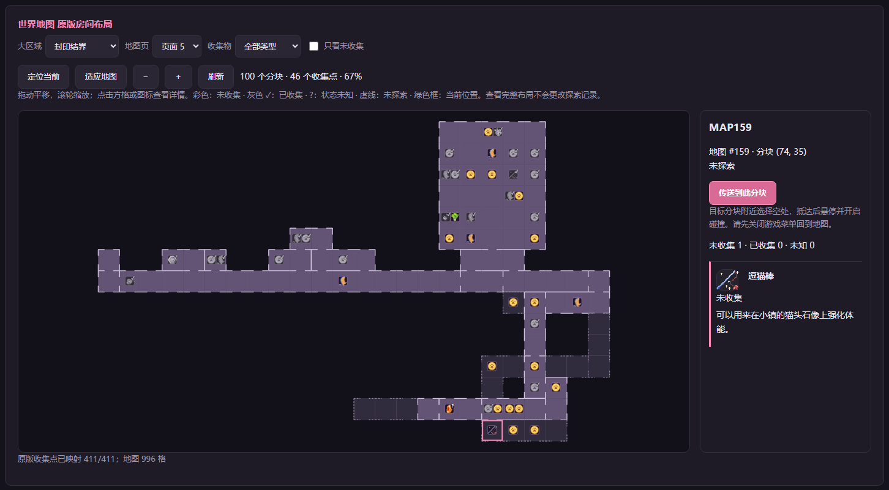
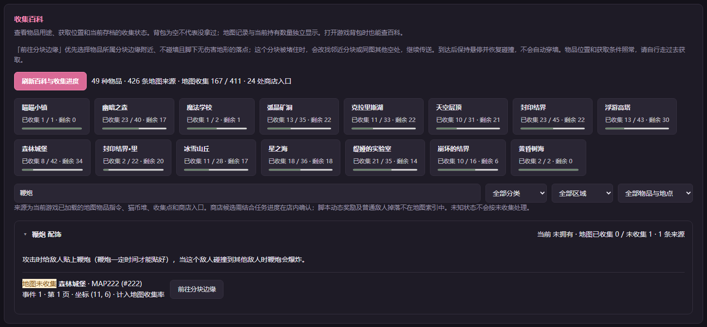
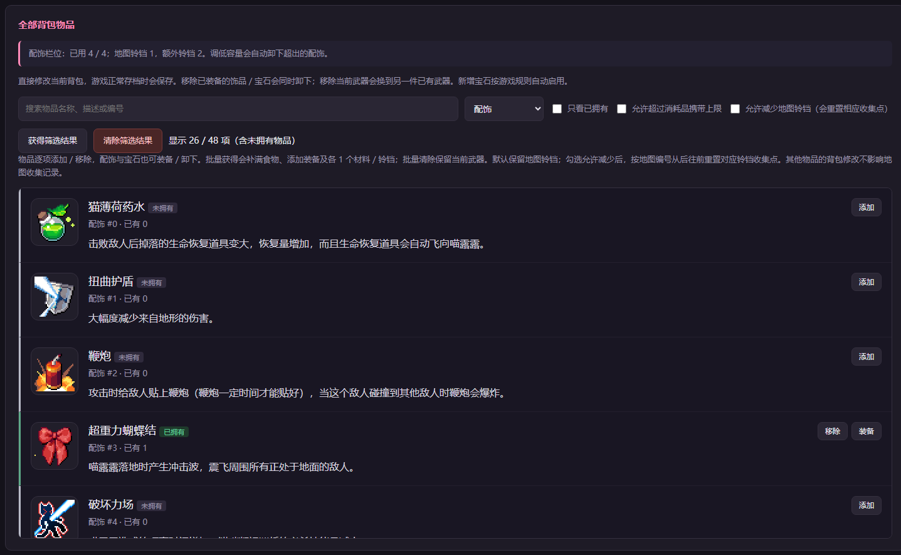

# 咸鱼喵喵全能助手 V1.1

**修改器 · 全收集地图 · 物品百科 · 剧情回看 · 截图摆拍**

想回头截一段剧情、找漏掉的收集物，或者试试不同配饰搭配？这个工具把常用操作放进了浏览器面板：游戏开在一边，查地图、调背包、找台词都在另一边完成。

支持 Windows 版《咸鱼喵喵》（Nyaruru）。推荐先用面板创建一份独立游戏副本，在副本里截图和尝试各种玩法。

## 看地图，补收集

世界地图按原作的房间和通道排列，能看见完整区域布局，也能定位自己现在在哪。拖动平移、滚轮缩放，放大后直接看每个分块里的收集物。

- **找漏项**：未收集显示彩色图标，拿过的变灰并带 ✓，暂时无法判断的显示 ?；可以只看未收集，或按物品类型筛选。
- **查位置**：点一个格子或图标，右侧显示该分块的物品、来源和获取条件。
- **去附近**：选好分块，再点「传送到此分块」。工具会找附近能容纳角色的位置，目标被挡住时改用备用位置，并显示到达提示。

当前版本整理了 **16 个区域、12 个地图页、996 个分块**。地图是房间布局示意图，查看完整地图不会改变游戏自己的探索记录。



收集百科适合反过来查：先搜物品，再看用途、获取位置和收集进度。例如，想找某件配饰，就搜名字、展开来源，再前往对应分块附近。

百科整理了 **49 种物品、426 条地图来源和 24 处商店入口**，覆盖当前版本 **411 个地图收集点**。它会分别显示「背包现在有多少」与「地图上是否拿过」，吃掉的食物不会因此变回未收集。



## 改背包，试搭配

「角色与背包」页列出 **48 项物品，包括 26 种配饰**，带游戏图标和效果说明。可以按名称搜索、按类别筛选，逐项添加、删除、装备或卸下，也可以批量获得或清除筛选结果。

想快速试一套配饰，就筛选「配饰」，找到想要的几件并装备；想补给，则筛选食物后批量获得。配饰容量跟随铃铛数量，面板会显示当前容量。

同一页还能调整：

- **金币、生命（HP）、体力（SP）、能量（ZP）**：直接设值，或分别锁定。
- **伤害与受击倍率**：1 倍为正常，可分别调整。
- **一击秒杀**：有效攻击命中时生效，剧情里的无敌阶段仍按游戏规则处理。

顶部还有常驻的「无敌」快捷开关，切换页面时也能随手开启或关闭。



## 回看剧情，慢慢取景

「对话剧情」支持按台词、说话人、地图或故事编号搜索。连接游戏后会自动读取全文台词，断开连接后清空，再次连接时重新读取。

找到想看的片段后，可以选择：

| 操作 | 适合什么时候用 |
| --- | --- |
| 前往 | 去剧情发生的位置，自己走过去触发 |
| 只播台词 | 想快速重看某一段对白或截对话框 |
| 运行过场 | 想连同人物站位和动作一起回看；会从所在事件页开头播放 |
| 临时摆拍 | 场景里缺了角色时，让角色临时出现，拍完点「撤销场景还原」 |

取景时不用一直和跳跃时机较劲：

- **悬停**：停在空中，每次点跳都能继续上升；按住游戏「下」键下降，松开停住。保留技能位移、地形碰撞和正常出口换图。
- **穿墙**：需要穿过障碍时单独开启；回到空处后关闭，再选择落地。
- **像素微调**：按 1、4 或 16 像素调整位置，方向按钮支持长按。
- **隐藏画面元素**：随时切换对话框、立绘、游戏界面和莉莉娅的显示，让构图更干净。

## 第一次使用

准备好已安装的游戏，再安装或下载这两个运行环境：

- [Node.js 22 或更新版本](https://nodejs.org/)：安装即可。
- [NW.js SDK 0.64.1 · Windows x64](https://dl.nwjs.io/v0.64.1/nwjs-sdk-v0.64.1-win-x64.zip)：完整解压，稍后放进工具文件夹。

工具无需运行 `npm install`。仓库和发布包不包含游戏本体、存档或完整剧本，地图、图标和全文台词会从你的游戏中读取。

1. **找到游戏目录。** 在 Steam 中右键游戏 → 管理 → 浏览本地文件。
2. **放入工具和 SDK。** 将下载解压后包含 `tool`、`out`、`unpacked` 的整个文件夹放进游戏目录，外层名字随意；再把完整的 `nwjs-sdk-v0.64.1-win-x64` 文件夹放到工具文件夹里。目录像这样：

   ```text
   游戏目录/
   ├─ package.json
   └─ Nyaruru_modifier/           ← 工具文件夹，名字不限
      ├─ README.md
      ├─ nwjs-sdk-v0.64.1-win-x64/
      │  ├─ nw.exe
      │  └─ ……                   ← SDK 的其他文件也要保留
      ├─ out/
      ├─ unpacked/
      └─ tool/
         ├─ 启动.bat
         └─ 停止面板.bat
   ```

3. **先创建游戏副本。** 在原游戏中正常保存并退出。双击 `tool/启动.bat`，首次选择 **1：只启动面板**，到「存档与沙盒」页创建副本。这里的「沙盒」就是一份单独运行的游戏副本，会额外占用磁盘空间。
4. **启动副本并读档。** 创建完成后再次双击 `启动.bat`，工具会备份存档并启动副本游戏。在游戏里正常读档进入地图，查看面板顶部的「当前连接」，确认连的是沙盒副本。
5. **打开想用的页面。** 查漏项用「地图」或「收集百科」，改物品用「角色与背包」，找台词用「对话剧情」。

面板默认地址：**http://127.0.0.1:8787**。用完双击 `tool/停止面板.bat`，游戏窗口另外关闭。升级时先退出旧面板和游戏，再替换工具文件。

## 用之前记住这几件事

- **在副本里试更省心。** 改过的数值、物品和剧情进度可能随正常存档保留；「全部还原」会解除辅助和锁定，已经改过的内容要靠存档备份恢复。备份和还原都在「存档与沙盒」页。
- **传送是帮你到附近。** 物品仍需自己取得，剧情条件和商店库存仍跟随游戏进度；地图传送前先退出游戏菜单，回到地图画面。
- **过场可能推动剧情。** 只想看对白就用「只播台词」；临时摆拍结束后先撤销，再继续游玩或保存。

遇到具体操作问题，可以查看 [使用须知](tool/使用须知.md)；想了解配置和源码，可看 [开发文档](tool/开发文档.md) 与 [更新记录](CHANGELOG.md)。上面的数量对应当前整理的游戏版本，其他版本以面板实际读取为准。
